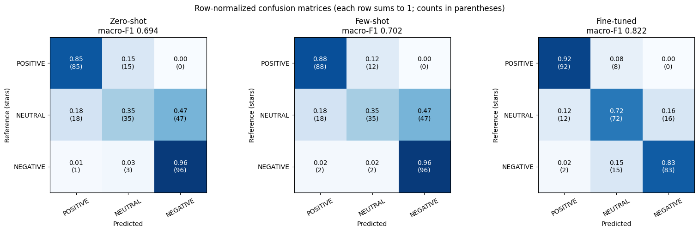

# Fine-Tuning vs. Prompting: Gift Card Review Sentiment

This part of the project compares three ways of labeling Amazon gift card reviews as **positive**, **neutral**, or **negative**. The models see only each review's title and text, never the star rating. The star rating is used as the correct answer afterwards.

| Approach | Model | What it gets |
|---|---|---|
| Zero-shot | Hosted Qwen3.6-35B-A3B (35B total, ~3B active) | Instructions only |
| Few-shot | Same hosted model | Instructions + 6 labeled training examples |
| Fine-tuned | Qwen3-4B-Instruct-2507 (~4B, 4-bit) + LoRA adapter | Instructions only, after training on 900 labeled reviews |

All three use the same instructions (the 3-class prompt from the main project), greedy decoding, at most 8 output tokens, and no "thinking" step. All three were scored on the same 300 test reviews, 100 per class.

## Results

| Approach | Balanced accuracy | Macro-F1 | Correct / 300 | Neutral recall |
|---|---|---|---|---|
| Zero-shot | 0.720 | 0.694 | 216 | 0.35 |
| Few-shot | 0.730 | 0.702 | 219 | 0.35 |
| **Fine-tuned** | **0.823** | **0.822** | **247** | **0.72** |

- **The small fine-tuned model beat the 35B model.** Almost all of the gain is on 3-star reviews. The hosted model called 47 of 100 neutral reviews negative, and the fine-tuned model recovered 72 of 100.
- **The tradeoff:** the fine-tuned model is more willing to call mild complaints neutral, so its negative recall fell from 0.96 to 0.83.
- **Statistics:** exact McNemar tests show fine-tuning vs. either prompting approach is unlikely to be chance (p ≈ 0.0002 and 0.0004). Zero-shot vs. few-shot is not distinguishable (p = 0.63).
- **Cost:** 21.6 minutes of training on a free Colab **Tesla T4**, peaking at 3.9 GB of GPU memory.

The full write-up, including errors, limits, and what was verified, is in the report at the bottom of the notebook.

## Files

| File | What it is |
|---|---|
| [`MBAX6418_Assignment4_FineTuning.ipynb`](MBAX6418_Assignment4_FineTuning.ipynb) | Executed Colab notebook: data splits and checks, prompts, hosted predictions, training, saved-adapter inference, comparison, and report |
| [`finetuned_test_predictions.csv`](finetuned_test_predictions.csv) | Fine-tuned model's predictions for the 300 test reviews, with raw responses |
| [`prompt_examples.jsonl`](prompt_examples.jsonl) | Three actual fine-tuned test prompts, one per class |
| [`figures/`](figures/) | Training loss and confusion matrices |
| LoRA adapter (122 MB ZIP) | Too large for a GitHub file. Download it from the [**a4-adapter-v1 release**](https://github.com/jamesonjdavis/Sentiment-Emotion-Classification-of-Amazon-Reviews/releases/tag/a4-adapter-v1). |

## Reproducing

1. Open the notebook in Google Colab and select a **T4 GPU** runtime.
2. Add a Colab secret named `CLASS_API_KEY` for the hosted model endpoint. The key is not stored in the notebook.
3. Run all cells. The notebook downloads the dataset itself ([Amazon Reviews '23, Gift Cards](https://amazon-reviews-2023.github.io)).

To run only the fine-tuned model **without retraining**, download the adapter ZIP from the release. Then run the setup cells, the prompt cell, and section 6 ("Saved-adapter inference"). It loads the adapter onto the base model `unsloth/Qwen3-4B-Instruct-2507-unsloth-bnb-4bit`.

*Built for MBAX 6418, Assignment 4.*
